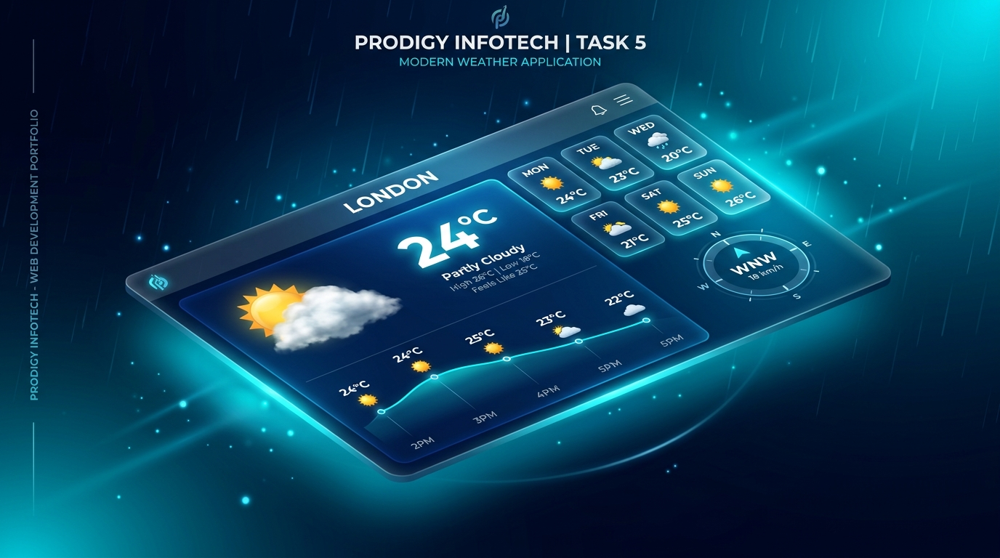

# SkyCast &bull; Real-Time Weather Dashboard
### Prodigy InfoTech &mdash; Web Development Internship (Task 05)



<div align="center">

[](https://shoeb2317.github.io/PRODIGY_WD_05/)
[](https://github.com/shoeb2317/PRODIGY_WD_05)
[](https://opensource.org/licenses/MIT)

**[🔗 Click Here to Open the Live Demo](https://shoeb2317.github.io/PRODIGY_WD_05/)**

</div>

---

## 📖 Overview
**SkyCast** is an atmospheric, real-time weather forecasting web application developed for **Prodigy InfoTech Task 5**. It fetches live, hyper-accurate global weather data based on the user's current location or any searched location worldwide.

The application features glassmorphism UI design, dynamic canvas weather effects, interactive temperature trend curves, a 24-hour hourly projection deck, and an extended 7-day outlook.

---

## ✨ Key Features

- **Dual Geolocation**:
  - **Instant Automatic Location**: Identifies the user's region immediately upon opening using network IP reverse geocoding (no permission delays or blank states).
  - **Precise GPS Tracking**: Dedicated **"My Location"** button requests high-precision device GPS coordinates.
- **Global Search with Live Autocomplete**:
  - Debounced real-time city search powered by Open-Meteo Geocoding.
  - Results show city name, administrative region, country, and national flag emoji.
  - Keyboard accessible (`ArrowUp`, `ArrowDown`, `Enter`, `Escape`).
  - Popular quick-access chips (Tokyo, London, New York, Paris, Sydney, Dubai, Mumbai) and custom local favorites.
- **Dynamic Atmospheric Canvas**:
  - Real-time particle system tailored to the current weather condition:
    - **Clear Sky / Sunshine**: Floating glowing sun motes and radial flares.
    - **Night Sky**: Twinkling starlight field.
    - **Rain / Drizzle**: Fluid falling rain streaks with wind drift.
    - **Thunderstorm**: Rainfall coupled with realistic atmospheric lightning pulses.
    - **Snow**: Swaying snowfall particles.
    - **Fog / Mist**: Ambient drifting fog haze.
- **Rich Metric Cards**:
  - **Hero Display**: Live temperature, animated weather SVG icon, condition badge, "Feels Like" index, and day High/Low.
  - **360° Compass Dial**: Interactive rotating needle indicating live wind direction, wind speed, and gusts.
  - **Humidity Gauge**: Percentage meter with comfort level analysis.
  - **UV Index Meter**: 0–11+ risk meter with health and safety exposure guidance.
  - **Astronomical Sun Cycle**: Arc path showing the sun's exact trajectory between sunrise and sunset.
  - **Barometric Pressure & Cloud Cover**: Air pressure level gauge and current precipitation.
- **24-Hour Hourly Forecast**:
  - Smooth SVG bezier temperature curve chart with soft gradient fill.
  - Hourly cards with icons, temps, and precipitation probabilities.
- **7-Day Extended Forecast**:
  - Week-relative temperature range bars showing where each day's temperatures fall compared to weekly extremes.
- **Units & Accessibility**:
  - Instant 1-click toggle between **Celsius (°C)** and **Fahrenheit (°F)** (also adjusts wind speed between km/h and mph).
  - Fully responsive glassmorphism layout optimized for mobile, tablet, and desktop viewports.

---

## 🛠️ Technology Stack

- **HTML5**: Semantic tags, accessible ARIA attributes, SEO metadata.
- **CSS3 (Vanilla)**: Glassmorphism tokens, CSS custom properties, responsive CSS Grid and Flexbox, GPU-accelerated micro-animations.
- **JavaScript (ES6+)**: Vanilla modular JS, Canvas 2D particle simulation, SVG geometry math, async REST APIs.
- **APIs**:
  - [Open-Meteo Weather API](https://open-meteo.com/): Free global weather data without rate-limiting or API key requirements.
  - [Open-Meteo Geocoding API](https://open-meteo.com/en/docs/geocoding-api): Live location search.
  - [BigDataCloud Client Geolocation](https://www.bigdatacloud.com/): Fast client IP and reverse geocoding.

---

## 🚀 Live Demo & Deployment

The application is hosted live via GitHub Pages:

👉 **[https://shoeb2317.github.io/PRODIGY_WD_05/](https://shoeb2317.github.io/PRODIGY_WD_05/)**

---

## 💻 Local Setup

1. **Clone the repository**:
   ```bash
   git clone https://github.com/shoeb2317/PRODIGY_WD_05.git
   cd PRODIGY_WD_05
   ```

2. **Run locally**:
   - Using Python:
     ```bash
     python -m http.server 3000
     ```
   - Or simply open `index.html` in any modern web browser.

---

## 👨‍💻 Author

**Shoeb Tahsildar**
- GitHub: [@shoeb2317](https://github.com/shoeb2317)
- Internship: **Prodigy InfoTech** (Web Development Track)
